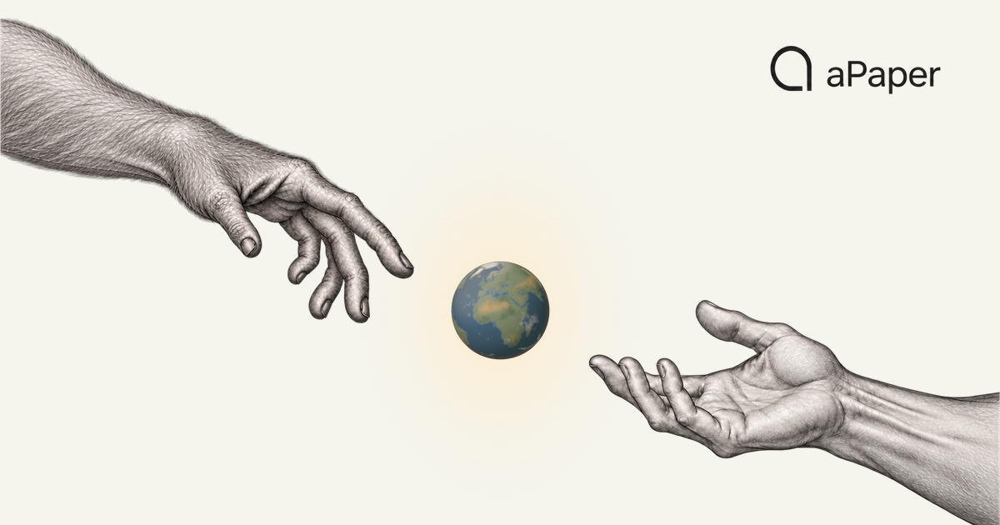

  
  
<strong>English</strong> · <a href="./README.zh-CN.md">简体中文</a>

# aPaper Cloud

aPaper Cloud hosts public update metadata and research resources used by the aPaper App. The App source and private user data are maintained separately.

[Website](https://cloud.apaper.ai) · [Contact](mailto:contact@apaper.ai)

## Public resources

| Resource | Public path | Purpose |
| --- | --- | --- |
| macOS App updates | [Stable appcast](https://cloud.apaper.ai/v1/app/macos/arm64/stable/appcast.xml) | Offers an App update only after its archive has been published and verified. |
| Literature catalog | [Version](https://cloud.apaper.ai/v1/conferences/version.json) · [Manifest](https://cloud.apaper.ai/v1/conferences/manifest.json) | Lists available conference and journal metadata packs with checksums. |
| Dogzee model groups | [Policy JSON](https://cloud.apaper.ai/v1/config/dogzee-group-policy.v1.json) | Public group names, model reasoning options, and agent defaults. |

App installers are published in [aPaper Releases](https://github.com/YociLam/aPaper/releases). Verified update archives, when available, are published in this repository's [Releases](https://github.com/YociLam/aPaper-Cloud/releases). The translator and its runtime environment are bundled inside each App archive and update with the App; they are not separate Cloud downloads.

Current stable: no verified update is currently offered.

## Literature packs

Catalog version: **0.16** · Updated (UTC): **2026-10-14T16:12:47Z**

31 sources: 25 conferences and 6 journals, with 72 packs across 77 annual entries. Tables follow the Manifest’s OECD disciplines; interdisciplinary sources appear in each applicable category.

### Computer and information sciences

| Type | Source | 2022 | 2023 | 2024 | 2025 | 2026 |
| --- | --- | ---: | ---: | ---: | ---: | ---: |
| Conference | NeurIPS | — | [3,540](https://cloud.apaper.ai/v1/conferences/packs/neurips/2023.jsonl.zst) | [4,493](https://cloud.apaper.ai/v1/conferences/packs/neurips/2024.jsonl.zst) | [5,823](https://cloud.apaper.ai/v1/conferences/packs/neurips/2025.jsonl.zst) | announced |
| Conference | ICML | — | [1,828](https://cloud.apaper.ai/v1/conferences/packs/icml/2023.jsonl.zst) | [2,610](https://cloud.apaper.ai/v1/conferences/packs/icml/2024.jsonl.zst) | [3,330](https://cloud.apaper.ai/v1/conferences/packs/icml/2025.jsonl.zst) | [6,552](https://cloud.apaper.ai/v1/conferences/packs/icml/2026.jsonl.zst) |
| Conference | ICLR | — | [435](https://cloud.apaper.ai/v1/conferences/packs/iclr/2023.jsonl.zst) (partial) | [2,261](https://cloud.apaper.ai/v1/conferences/packs/iclr/2024.jsonl.zst) (partial) | [3,708](https://cloud.apaper.ai/v1/conferences/packs/iclr/2025.jsonl.zst) (partial) | [5,359](https://cloud.apaper.ai/v1/conferences/packs/iclr/2026.jsonl.zst) (partial) |
| Conference | CVPR | — | [2,352](https://cloud.apaper.ai/v1/conferences/packs/cvpr/2023.jsonl.zst) | [2,710](https://cloud.apaper.ai/v1/conferences/packs/cvpr/2024.jsonl.zst) | [2,871](https://cloud.apaper.ai/v1/conferences/packs/cvpr/2025.jsonl.zst) | [4,068](https://cloud.apaper.ai/v1/conferences/packs/cvpr/2026.jsonl.zst) |
| Conference | ACL | — | [2,150](https://cloud.apaper.ai/v1/conferences/packs/acl/2023.jsonl.zst) | [1,982](https://cloud.apaper.ai/v1/conferences/packs/acl/2024.jsonl.zst) | [3,353](https://cloud.apaper.ai/v1/conferences/packs/acl/2025.jsonl.zst) | [4,806](https://cloud.apaper.ai/v1/conferences/packs/acl/2026.jsonl.zst) (partial) |
| Conference | AAAI | — | [1,578](https://cloud.apaper.ai/v1/conferences/packs/aaai/2023.jsonl.zst) | [2,331](https://cloud.apaper.ai/v1/conferences/packs/aaai/2024.jsonl.zst) | [3,028](https://cloud.apaper.ai/v1/conferences/packs/aaai/2025.jsonl.zst) | [4,149](https://cloud.apaper.ai/v1/conferences/packs/aaai/2026.jsonl.zst) |
| Conference | IJCAI | — | [850](https://cloud.apaper.ai/v1/conferences/packs/ijcai/2023.jsonl.zst) | [1,047](https://cloud.apaper.ai/v1/conferences/packs/ijcai/2024.jsonl.zst) | [1,279](https://cloud.apaper.ai/v1/conferences/packs/ijcai/2025.jsonl.zst) | [972](https://cloud.apaper.ai/v1/conferences/packs/ijcai/2026.jsonl.zst) |
| Conference | EMNLP | — | [2,241](https://cloud.apaper.ai/v1/conferences/packs/emnlp/2023.jsonl.zst) | [2,388](https://cloud.apaper.ai/v1/conferences/packs/emnlp/2024.jsonl.zst) | [3,488](https://cloud.apaper.ai/v1/conferences/packs/emnlp/2025.jsonl.zst) | announced |
| Conference | ICCV | — | [2,156](https://cloud.apaper.ai/v1/conferences/packs/iccv/2023.jsonl.zst) | — | [2,701](https://cloud.apaper.ai/v1/conferences/packs/iccv/2025.jsonl.zst) | — |
| Conference | ECCV | [1,645](https://cloud.apaper.ai/v1/conferences/packs/eccv/2022.jsonl.zst) | — | [2,387](https://cloud.apaper.ai/v1/conferences/packs/eccv/2024.jsonl.zst) | — | announced |
| Conference | AISTATS | — | — | [547](https://cloud.apaper.ai/v1/conferences/packs/aistats/2024.jsonl.zst) | [583](https://cloud.apaper.ai/v1/conferences/packs/aistats/2025.jsonl.zst) | [588](https://cloud.apaper.ai/v1/conferences/packs/aistats/2026.jsonl.zst) |
| Conference | COLT | — | — | — | [181](https://cloud.apaper.ai/v1/conferences/packs/colt/2025.jsonl.zst) | [196](https://cloud.apaper.ai/v1/conferences/packs/colt/2026.jsonl.zst) |
| Conference | AAMAS | — | — | — | [479](https://cloud.apaper.ai/v1/conferences/packs/aamas/2025.jsonl.zst) | [640](https://cloud.apaper.ai/v1/conferences/packs/aamas/2026.jsonl.zst) (partial) |
| Conference | CoRL | — | — | [264](https://cloud.apaper.ai/v1/conferences/packs/corl/2024.jsonl.zst) (partial) | [263](https://cloud.apaper.ai/v1/conferences/packs/corl/2025.jsonl.zst) | — |
| Conference | RSS | — | — | [134](https://cloud.apaper.ai/v1/conferences/packs/rss/2024.jsonl.zst) | [163](https://cloud.apaper.ai/v1/conferences/packs/rss/2025.jsonl.zst) | [210](https://cloud.apaper.ai/v1/conferences/packs/rss/2026.jsonl.zst) |
| Conference | OSDI | — | [55](https://cloud.apaper.ai/v1/conferences/packs/osdi/2023.jsonl.zst) | [53](https://cloud.apaper.ai/v1/conferences/packs/osdi/2024.jsonl.zst) | [53](https://cloud.apaper.ai/v1/conferences/packs/osdi/2025.jsonl.zst) | [136](https://cloud.apaper.ai/v1/conferences/packs/osdi/2026.jsonl.zst) |
| Conference | SOSP | — | [9](https://cloud.apaper.ai/v1/conferences/packs/sosp/2023.jsonl.zst) (partial) | [43](https://cloud.apaper.ai/v1/conferences/packs/sosp/2024.jsonl.zst) (partial) | [65](https://cloud.apaper.ai/v1/conferences/packs/sosp/2025.jsonl.zst) (partial) | — |
| Conference | IEEE S&P | — | cataloged | [261](https://cloud.apaper.ai/v1/conferences/packs/ieee_sp/2024.jsonl.zst) | [65](https://cloud.apaper.ai/v1/conferences/packs/ieee_sp/2025.jsonl.zst) | 254 (partial; no pack) |
| Conference | NDSS | — | [94](https://cloud.apaper.ai/v1/conferences/packs/ndss/2023.jsonl.zst) | [140](https://cloud.apaper.ai/v1/conferences/packs/ndss/2024.jsonl.zst) | [211](https://cloud.apaper.ai/v1/conferences/packs/ndss/2025.jsonl.zst) | [265](https://cloud.apaper.ai/v1/conferences/packs/ndss/2026.jsonl.zst) |
| Conference | ACCV | [277](https://cloud.apaper.ai/v1/conferences/packs/accv/2022.jsonl.zst) | — | [269](https://cloud.apaper.ai/v1/conferences/packs/accv/2024.jsonl.zst) | — | — |
| Conference | MIDL | — | — | — | — | [221](https://cloud.apaper.ai/v1/conferences/packs/midl/2026.jsonl.zst) |
| Conference | MLHC | — | — | — | — | [74](https://cloud.apaper.ai/v1/conferences/packs/mlhc/2026.jsonl.zst) |
| Conference | CHIL | — | — | — | — | [40](https://cloud.apaper.ai/v1/conferences/packs/chil/2026.jsonl.zst) |
| Conference | MLCB | — | — | — | [23](https://cloud.apaper.ai/v1/conferences/packs/mlcb/2025.jsonl.zst) | — |
| Conference | L4DC | — | — | — | — | [106](https://cloud.apaper.ai/v1/conferences/packs/l4dc/2026.jsonl.zst) |

### Mathematics

| Type | Source | 2022 | 2023 | 2024 | 2025 | 2026 |
| --- | --- | ---: | ---: | ---: | ---: | ---: |
| Conference | AISTATS | — | — | [547](https://cloud.apaper.ai/v1/conferences/packs/aistats/2024.jsonl.zst) | [583](https://cloud.apaper.ai/v1/conferences/packs/aistats/2025.jsonl.zst) | [588](https://cloud.apaper.ai/v1/conferences/packs/aistats/2026.jsonl.zst) |
| Conference | COLT | — | — | — | [181](https://cloud.apaper.ai/v1/conferences/packs/colt/2025.jsonl.zst) | [196](https://cloud.apaper.ai/v1/conferences/packs/colt/2026.jsonl.zst) |

### Biological sciences

| Type | Source | 2022 | 2023 | 2024 | 2025 | 2026 |
| --- | --- | ---: | ---: | ---: | ---: | ---: |
| Conference | MLCB | — | — | — | [23](https://cloud.apaper.ai/v1/conferences/packs/mlcb/2025.jsonl.zst) | — |
| Journal | PLOS Biology | — | — | — | — | [365](https://cloud.apaper.ai/v1/conferences/packs/plos_biology/2026.jsonl.zst) |

### Electrical engineering, electronic engineering, information engineering

| Type | Source | 2022 | 2023 | 2024 | 2025 | 2026 |
| --- | --- | ---: | ---: | ---: | ---: | ---: |
| Conference | CoRL | — | — | [264](https://cloud.apaper.ai/v1/conferences/packs/corl/2024.jsonl.zst) (partial) | [263](https://cloud.apaper.ai/v1/conferences/packs/corl/2025.jsonl.zst) | — |
| Conference | RSS | — | — | [134](https://cloud.apaper.ai/v1/conferences/packs/rss/2024.jsonl.zst) | [163](https://cloud.apaper.ai/v1/conferences/packs/rss/2025.jsonl.zst) | [210](https://cloud.apaper.ai/v1/conferences/packs/rss/2026.jsonl.zst) |
| Conference | L4DC | — | — | — | — | [106](https://cloud.apaper.ai/v1/conferences/packs/l4dc/2026.jsonl.zst) |

### Medical engineering

| Type | Source | 2022 | 2023 | 2024 | 2025 | 2026 |
| --- | --- | ---: | ---: | ---: | ---: | ---: |
| Conference | MIDL | — | — | — | — | [221](https://cloud.apaper.ai/v1/conferences/packs/midl/2026.jsonl.zst) |

### Health sciences

| Type | Source | 2022 | 2023 | 2024 | 2025 | 2026 |
| --- | --- | ---: | ---: | ---: | ---: | ---: |
| Conference | MLHC | — | — | — | — | [74](https://cloud.apaper.ai/v1/conferences/packs/mlhc/2026.jsonl.zst) |
| Conference | CHIL | — | — | — | — | [40](https://cloud.apaper.ai/v1/conferences/packs/chil/2026.jsonl.zst) |
| Journal | PLOS Medicine | — | — | — | — | [175](https://cloud.apaper.ai/v1/conferences/packs/plos_medicine/2026.jsonl.zst) |
| Journal | PLOS Global Public Health | — | — | — | — | [817](https://cloud.apaper.ai/v1/conferences/packs/plos_global_public_health/2026.jsonl.zst) |

### Earth and related environmental sciences

| Type | Source | 2022 | 2023 | 2024 | 2025 | 2026 |
| --- | --- | ---: | ---: | ---: | ---: | ---: |
| Journal | PLOS Climate | — | — | — | — | [128](https://cloud.apaper.ai/v1/conferences/packs/plos_climate/2026.jsonl.zst) |

### Clinical medicine

| Type | Source | 2022 | 2023 | 2024 | 2025 | 2026 |
| --- | --- | ---: | ---: | ---: | ---: | ---: |
| Journal | PLOS Medicine | — | — | — | — | [175](https://cloud.apaper.ai/v1/conferences/packs/plos_medicine/2026.jsonl.zst) |

### Law

| Type | Source | 2022 | 2023 | 2024 | 2025 | 2026 |
| --- | --- | ---: | ---: | ---: | ---: | ---: |
| Journal | German Law Journal | — | — | — | — | [57](https://cloud.apaper.ai/v1/conferences/packs/glj/2026.jsonl.zst) |
| Journal | Journal of Law and the Biosciences | — | — | — | — | [10](https://cloud.apaper.ai/v1/conferences/packs/jlb/2026.jsonl.zst) (partial) |

Linked counts download a pack. “Partial” marks incomplete coverage; “cataloged” and “announced” have no pack; “—” means the Manifest has no entry for that year. Journal data for 2026 is a snapshot from January 1 through October 14, not full-year coverage. The Manifest is authoritative for counts, status, and availability.

The App uses versioned metadata and checksums to detect catalog changes and verify downloaded packs. The model policy contains public configuration only; account credentials and API keys are never stored here.

For publication and channel details, see the [App distribution contract](APP-DISTRIBUTION.md). To validate the public catalog locally, run the repository's catalog validator and tests.
